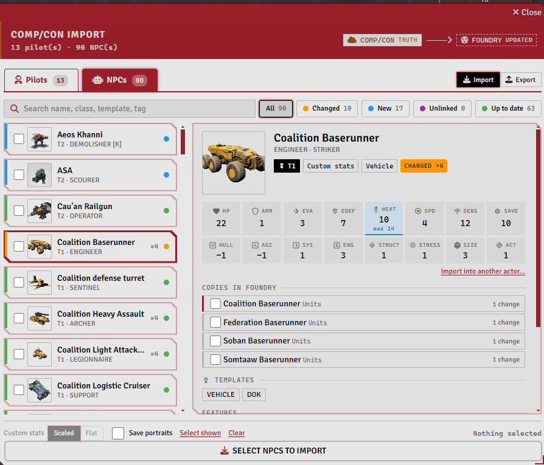

# Lancer Comp/Con Sync

[](https://github.com/Agraael/Lancer-vtt-NPC-import/releases/latest)

<br/>
[)](https://github.com/Agraael/Lancer-vtt-NPC-import/releases/latest)
[)](https://github.com/Agraael/Lancer-vtt-NPC-import/releases/latest)

---

Syncs Lancer pilots, mechs and NPCs between Comp/Con and FoundryVTT, both ways. Used to be Lancer NPC Import, it grew a bit.

## What it does

- **Comp/Con Sync**: import and export pilots, mechs and NPCs with your Comp/Con cloud.
- **JSON import**: Comp/Con export files, v2 and v3.
- **Pilot imports** bring more Comp/Con data (orgs, reserves, bond state), and the Lancer share-code button works again.
- **V3 LCP import** in the Compendium Manager.
- **v3 data on items**: what Lancer can't store from a v3 LCP, shown as chips.
- **Refresh**: re-pull updated compendium items onto existing actors.

## Install

Manifest URL:

```
https://github.com/Agraael/Lancer-vtt-NPC-import/releases/latest/download/module.json
```

Requires Foundry v13, the [Lancer system](https://foundryvtt.com/packages/lancer) 2.12.0+ and [Lancer Style Library](https://github.com/Agraael/lancer-style-library) 1.2.0+.

## Using it

Click **Comp/Con Sync** in the Actors sidebar and sign in with your Comp/Con account. Your password is never stored.

- Re-importing a pilot overwrites its talents, skills and core bonuses.
- Remote pilots don't show up. Use their share code on the pilot sheet.
- Export only works on imported actors. Sync in Comp/Con after. Backups go to `comp-con-backups/`.
- Custom NPC stats: **Scaled** keeps tier increments, **Flat** uses the same stats for every tier.
- Players only get pilots they own. New ones need the **Create Actors** permission.



## V3 LCP import

Pick a v3 `.lcp` in the Compendium Manager and click **Import v3 LCP**. Downtime actions go to [Lancer Automations](https://github.com/Agraael/lancer-automations) if it's installed.

<details>
<summary>How v3 content is translated</summary>

| v3 feature | Handling |
|---|---|
| `active_effects[]` bonuses / actions / deployables / synergies / counters | Lifted into the item's v2 arrays. Bonuses with their own condition, an accuracy, or an id Lancer Automations applies stay as v3 data instead |
| Action-shaped `active_effects[]` (damage / range / attack / accuracy / condition / frequency) | Synthesized as v2 actions. On NPC features they become text in the effect, not rollable actions |
| `save` (scalar or `.dc`) / `accuracy` / `bonus_damage` scalars | Kept as v3 data |
| `on_attack` / `on_hit` / `on_crit` / `on_miss` as objects | String-coerced; `on_attack` / `on_crit` merged into effect |
| `damage[].val` → `damage[].damage` | Renamed |
| NPC weapon tier arrays | Pass-through (Lancer handles natively) |
| Inline `integrated` items | Flattened to LID strings |
| `core_system.active_effects[]` / `passive_effects[]` | Fanned into `active_bonuses` / `active_actions` / `active_synergies` (+ passive) plus core `deployables` / `counters` |
| `add_status` / `add_resist` / `add_special` / `remove_special` | Kept as v3 data. On deployables they are also written as text |
| `duration` / `condition` / `target` (non-action AEs) | `condition` stays as text in the header, `duration` and `target` are kept as v3 data |
| `bonus_damage` on non-action AEs | Kept as v3 data |
| Structured `save.on_success` / `on_fail` | Text in effect (the save itself is kept as v3 data) |
| Eidolon layers | Each layer → NPC template + features, plus a "<Layer>'s Rules" and a "<Layer>'s Shard" trait, in an `Eidolons` folder. Apply manually, no layer-swap |
| `flavorDescription` / `brew` / `deprecated` | Dropped |

</details>

## v3 data on items

Shown as chips on sheets and chat cards, editable on the item sheet. [Lancer Automations](https://github.com/Agraael/lancer-automations) applies it.

## Refresh

**Refresh** in the actor sheet title bar, or **Refresh actors** in the Actors sidebar. Shows a diff, you pick what to apply.

## Tools

In the module settings: **LCP Diff Tool** (compares what two LCPs would import, send me that with a bad import report), **Share Code Test** and **Fix Token Sizes**.

## A note on CORS

The Comp/Con API blocks browser calls, so the module goes through corsproxy.io, then my Cloudflare Worker. If the Worker isn't responding, it's hit its daily limit. Try again in a few hours.

<details>
<summary>Advanced: endpoint overrides</summary>

If Massif changes keys or hosts, update these in the settings and reload.

- `V3 API Base URL`
- `V3 API Key`
- `V3 CDN Base URL`

</details>

---

<details>
<summary>patreon...</summary>

Well, project became bigger, now there's more people. So the Patreon is starting to get real. If you wanna support my late nights, that's here.

In any case, my stuff would always be free, and if I stop working on it, I'll just close that thing. [Patreon](https://www.patreon.com/cw/LaSossis)

</details>

Check out my other modules and tools: [List of stuff](https://www.patreon.com/posts/list-of-stuff-149377511)
