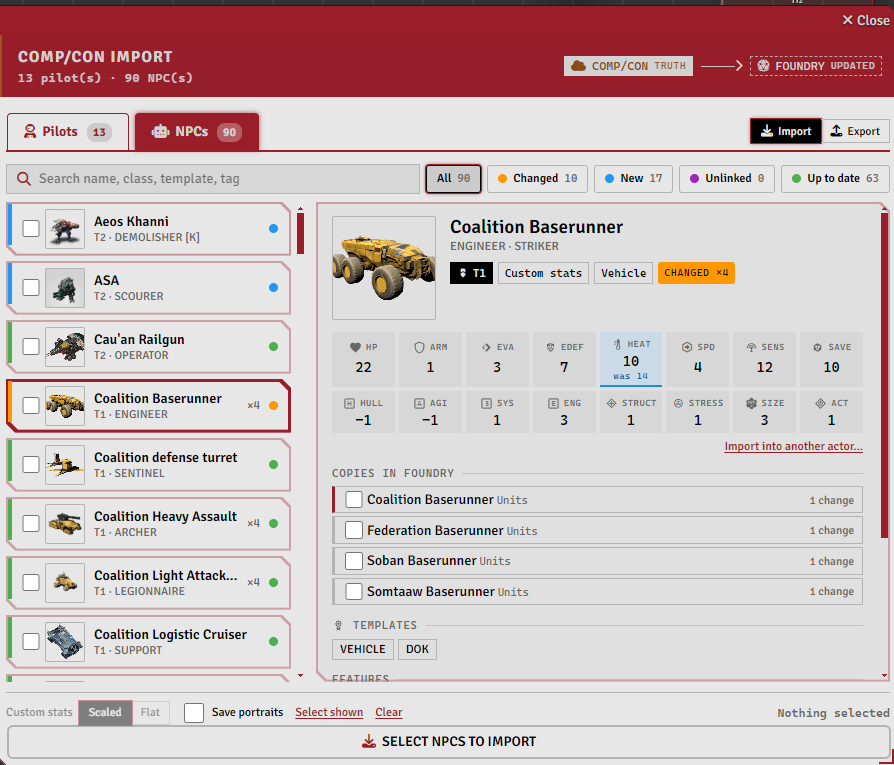

# Lancer Comp/Con Sync

[](https://github.com/Agraael/Lancer-vtt-NPC-import/releases/latest)

<br/>
[)](https://github.com/Agraael/Lancer-vtt-NPC-import/releases/latest)
[)](https://github.com/Agraael/Lancer-vtt-NPC-import/releases/latest)

---

Syncs Lancer pilots and NPCs between Comp/Con and FoundryVTT, both ways. Used to be Lancer NPC Import, it grew a bit.

## What it does

- **Comp/Con Sync**: import pilots (with their mechs) and NPCs from your Comp/Con cloud, or export your Foundry changes back to Comp/Con.
- **JSON import**: Comp/Con export files, pilots or NPCs, v2 and v3.
- **V3 LCP import**: an **Import v3 LCP** button in the Compendium Manager.
- **Refresh items from LCPs**: re-pull updated compendium items onto existing actors, with a diff first.
- **LCP Diff Tool** and **Fix Token Sizes** in the module settings.

## Install

Manifest URL:

```
https://github.com/Agraael/Lancer-vtt-NPC-import/releases/latest/download/module.json
```

Requires Foundry v13, the [Lancer system](https://foundryvtt.com/packages/lancer) 2.12.0+ and [Lancer Style Library](https://github.com/Agraael/lancer-style-library).

## Using it

Click **Comp/Con Sync** in the Actors sidebar and sign in with your Comp/Con account. Lancer v2.12 dropped the built-in login, so the module talks to AWS Cognito directly. Your password is never stored.

A few things worth knowing:
- Re-importing a pilot rebuilds all its items, so anything you added by hand in Foundry is gone.
- Export only works on actors that are already linked (ones you imported). Open Comp/Con and sync after. The Comp/Con file is backed up before each export, in `comp-con-backups/`.
- NPCs with custom stats: **Scaled** keeps the tier-to-tier increments, **Flat** uses the same stats for every tier.



## V3 LCP import

Open the Compendium Manager, pick a v3 `.lcp`, and an **Import v3 LCP** button shows up in place of the native one. v2 LCPs go through the normal Lancer importer.

<details>
<summary>How v3 content is translated</summary>

| v3 feature | Handling |
|---|---|
| `active_effects[]` bonuses / actions / deployables / synergies / counters | Lifted into the item's v2 arrays |
| Action-shaped `active_effects[]` (damage / range / attack / accuracy / condition / frequency) | Synthesized as v2 actions. On NPC features they become text in the effect, not rollable actions |
| `save` (scalar or `.dc`) / `accuracy` / `bonus_damage` scalars | Lifted into bonuses |
| `on_attack` / `on_hit` / `on_crit` / `on_miss` as objects | String-coerced; `on_attack` / `on_crit` merged into effect |
| `damage[].val` → `damage[].damage` | Renamed |
| NPC weapon tier arrays | Pass-through (Lancer handles natively) |
| Inline `integrated` items | Flattened to LID strings |
| `core_system.active_effects[]` / `passive_effects[]` | Fanned into `active_bonuses` / `active_actions` / `active_synergies` (+ passive) plus core `deployables` / `counters` |
| `add_status` / `add_resist` / `add_special` / `remove_special` | Text in effect (Lancer doesn't apply statuses from LCPs) |
| `duration` / `condition` / `target` (non-action AEs) | Text meta in header |
| `damage` / `bonus_damage` on non-action AEs | Text in effect |
| Structured `save.on_success` / `on_fail` | Text in effect (DC still goes to bonus) |
| Eidolon layers | Each layer → NPC template + features, plus a "<Layer>'s Rules" and a "<Layer>'s Shard" trait, in an `Eidolons` folder. Apply manually, no layer-swap |
| `flavorDescription` / `brew` / `deprecated` | Dropped |

</details>

## Refresh items from LCPs

**Refresh** in the actor sheet title bar, or **Refresh actors** in the Actors sidebar for all of them. Shows a per-item diff, you pick what to apply.

## LCP Diff Tool

There are way too many LCPs out there for me to test them all, so some translation edge cases probably slipped through. **Module Settings → Open LCP Diff Tool** compares what two LCPs would import, without importing anything. Mainly for LCP authors, and it gives me something concrete to look at when someone reports a bad import.

## A note on CORS

The Comp/Con API doesn't allow direct browser calls, so the module goes through a CORS proxy: corsproxy.io first, then my Cloudflare Worker.

If a red notification says the Worker isn't responding, it's hit its daily limit. Try again in a few hours.

**Bonus:** the Lancer system's own share-code button gets blocked by the same CORS rule. With this module installed it works again.

<details>
<summary>Advanced: endpoint overrides</summary>

If Massif rotates keys or moves hosts, you can update these endpoints in the settings without waiting for a module release. Reload the world after changing any of them.

- `V3 API Base URL`
- `V3 API Key`
- `V3 CDN Base URL`

</details>

---

<details>
<summary>patreon...</summary>

Well, project became bigger, now there's more people. So the Patreon is starting to get real. If you wanna support my late nights, that's here.

In any case, my stuff would always be free, and if I stop working on it, I'll just close that thing. [Patreon](https://www.patreon.com/cw/LaSossis)

</details>

Check out my other modules and tools: [List of stuff](https://www.patreon.com/posts/list-of-stuff-149377511)
